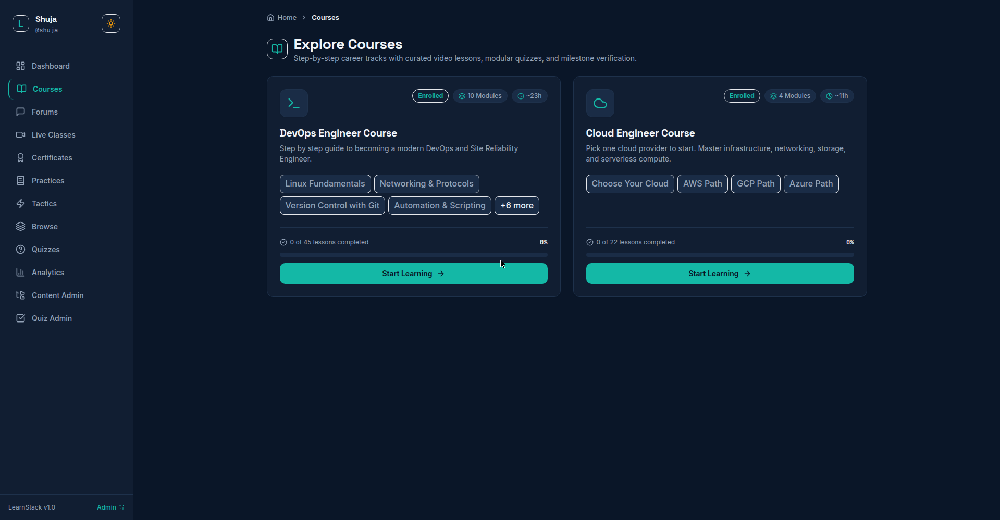
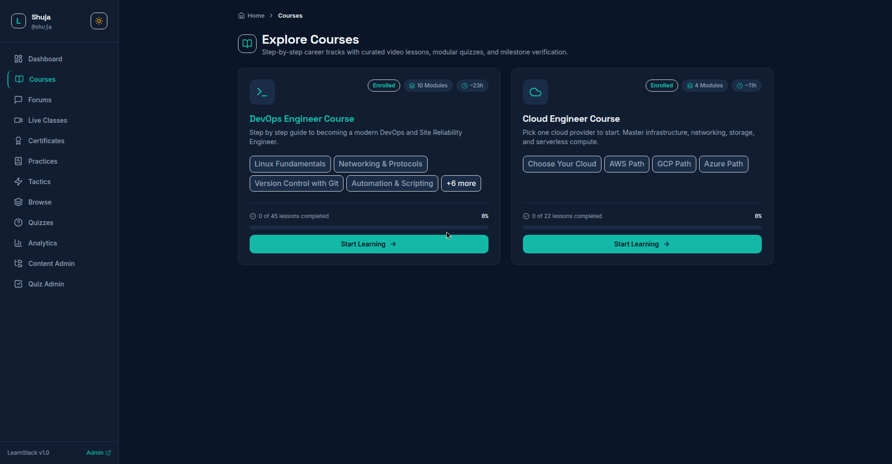
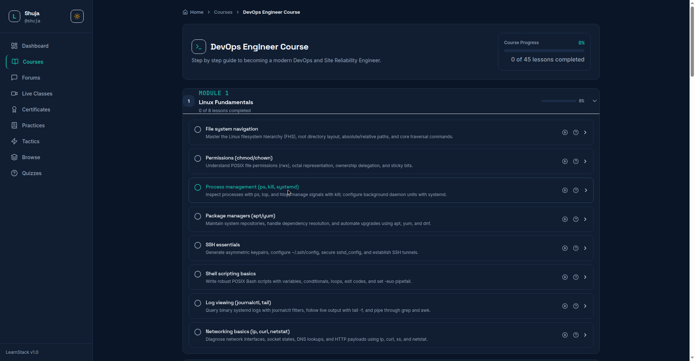
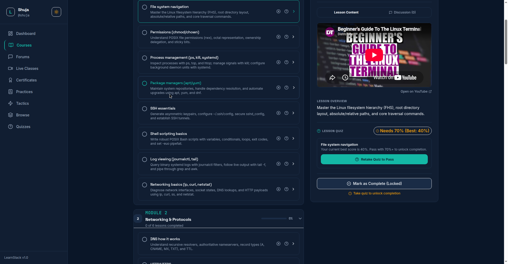
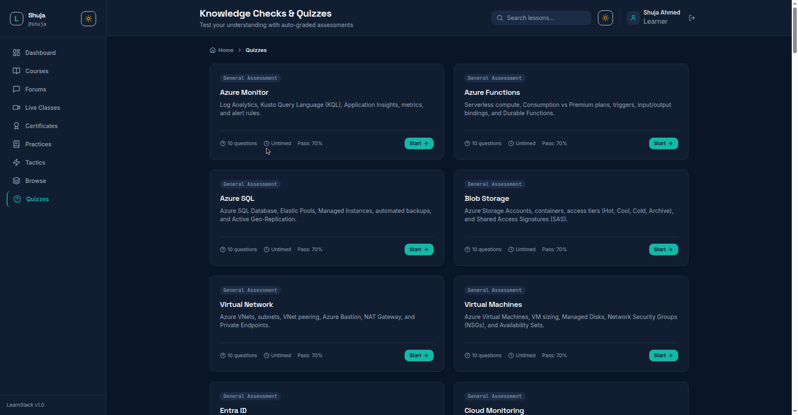
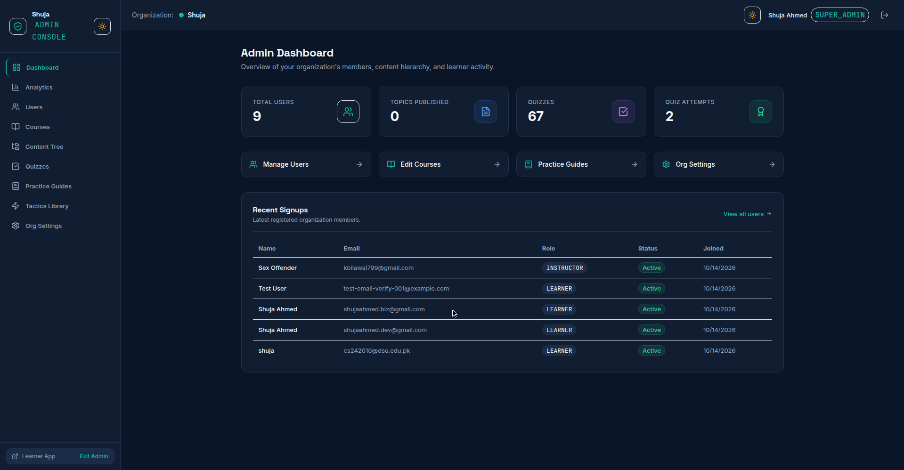
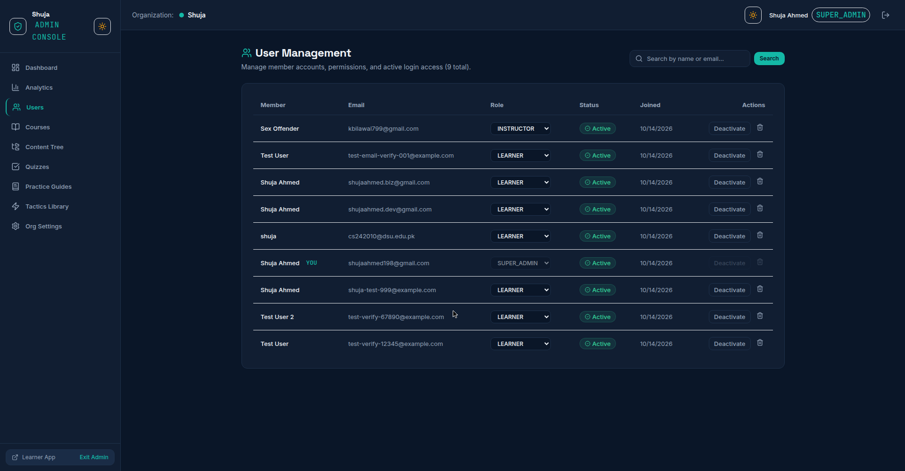
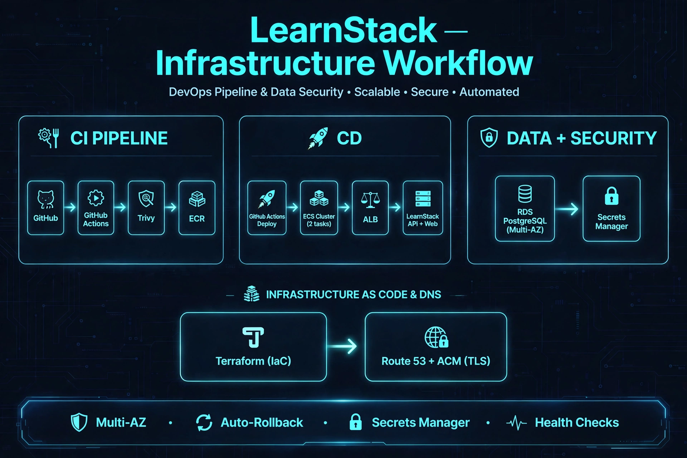

# LearnStack

A multi-tenant, white-label learning platform. Organizations get their own branded learning portal with courses, quizzes, discussion forums, live sessions, certificates, and analytics.

**Live:** https://app.shujaahmed.dev

## Features

- **Courses**: Modules, lessons, YouTube video embeds, search
- **Quizzes**: 10-question quizzes per lesson, 70% pass required, auto-grading, unlimited retakes
- **Discussion Forums**: Per-lesson Q&A threads
- **Live Sessions**: Scheduling, registration, countdown
- **Certificates**: PDF generation on course completion, public verification URL
- **Analytics**: Lesson funnels, quiz difficulty analysis, at-risk learner alerts
- **Admin Panel**: User management, course/quiz/guide/tactic management
- **Multi-tenant**: Organizations with role-based access (Super Admin, Org Admin, Instructor, Learner)
- **Themes**: Light and dark mode
- **Password Reset**: Email-based password recovery
- **Toast Notifications**: Non-blocking UI feedback

Everything is free. No payments, no SSO. Email/password authentication only.

## Development Stack

**Frontend:**
- React 18 with TypeScript
- Vite (build tool)
- Tailwind CSS (styling)
- Lucide icons
- React Router (navigation)
- Canvas Confetti (celebrations)

**Backend:**
- Node.js 20+
- TypeScript
- Fastify (web framework)
- Zod (validation)
- Prisma ORM
- Argon2id (password hashing)
- Nodemailer (Gmail for verification and password reset)
- Session cookies (auth)

**Database:**
- PostgreSQL (RDS Multi-AZ in production)
- Prisma migrations (15 applied)

**Monorepo:**
- pnpm workspaces
- apps/web, apps/api, packages/db, packages/shared

## Deployment Stack

**CI/CD:**
- GitHub Actions (CI: lint, typecheck, test)
- GitHub Actions (Deploy: Docker build --no-cache, push to ECR, update ECS)
- Trivy (security scan, non-blocking)

**AWS (us-east-1):**
- ECR (learnstack/api, learnstack/web)
- ECS Fargate (learnstack-api: 2 tasks, learnstack-web: 2 tasks)
- ALB (Application Load Balancer)
- RDS PostgreSQL Multi-AZ
- Secrets Manager (db-url, session-secret, email)
- Route 53 (app.shujaahmed.dev)
- ACM (TLS certificate)
- VPC with private subnets, NAT instance
- Rolling deployment with circuit breaker auto-rollback

**Infrastructure:**
- Terraform (IaC)

## Documentation

- **[User Guide](docs/USER_GUIDE.md)** - Step-by-step learner and admin walkthroughs
- **[Screenshots](docs/screenshots/README.md)** - Visual page reference for evaluators

## Screenshots

Dark mode preview of the learner and admin experience. Full gallery in [docs/screenshots](docs/screenshots/).

<table>
  <tr>
    <td><br/>Learner Dashboard</td>
    <td><br/>Courses</td>
    <td><br/>Course Detail</td>
  </tr>
  <tr>
    <td><br/>Lesson Expanded</td>
    <td><br/>Quizzes</td>
    <td><br/>Admin Dashboard</td>
  </tr>
  <tr>
    <td><br/>Admin Users</td>
    <td></td>
    <td></td>
  </tr>
</table>

## Workflow



## Run It Yourself

### Prerequisites

- Node.js 20+
- pnpm 8+
- Docker and Docker Compose
- PostgreSQL (or use Docker)

### Quick Start (Local Development)

1. **Clone the repo**
   ```bash
   git clone https://github.com/ShujaAhmed786/LearnStack.git
   cd LearnStack
   ```

2. **Start PostgreSQL**
   ```bash
   docker compose up -d
   ```
   This starts PostgreSQL on port 5432.

3. **Install dependencies**
   ```bash
   pnpm install
   ```

4. **Set up environment variables**
   ```bash
   cp apps/api/.env.example apps/api/.env
   ```
   Edit `apps/api/.env`:
   - `DATABASE_URL`: PostgreSQL connection string
   - `SESSION_SECRET`: Random string for session signing
   - `EMAIL_USER` / `EMAIL_PASS`: Gmail credentials for verification emails (optional)

5. **Run database migrations**
   ```bash
   pnpm --filter db exec prisma migrate dev
   ```

6. **Seed data** (optional)
   ```bash
   pnpm --filter db exec prisma db seed
   ```

7. **Start the dev servers**
   ```bash
   pnpm dev
   ```
   - Frontend: http://localhost:5173
   - API: http://localhost:3001

### Production Deployment (AWS)

Infrastructure is managed with Terraform in `infra/terraform/`:

- **Compute**: ECS with 2 tasks per service (API + Web)
- **Database**: RDS PostgreSQL Multi-AZ
- **Load Balancer**: Application Load Balancer with ACM TLS
- **DNS**: Route 53 (`app.shujaahmed.dev`)
- **Secrets**: AWS Secrets Manager (DB URL, session secret, email credentials)
- **Networking**: VPC with private subnets, NAT instance
- **CI/CD**: GitHub Actions → ECR → ECS rolling deploy with circuit breaker and auto-rollback

**Deploy:**
```bash
cd infra/terraform
terraform init
terraform plan
terraform apply
```

Pushing to `main` triggers the GitHub Actions Deploy workflow automatically.

See `infra/terraform/` for infrastructure details.

### CI/CD

GitHub Actions (`.github/workflows/`):
- **CI**: TypeScript type checking, linting, tests, Trivy security scan, Semgrep SAST
- **Deploy**: Docker builds (no-cache), push to ECR, ECS rolling deployment, health check smoke test

## Project Structure

```
LearnStack/
├── apps/
│   ├── api/          # Fastify backend
│   └── web/          # React frontend
├── packages/
│   ├── db/           # Prisma schema, migrations, seeds
│   └── shared/       # Shared TypeScript types
├── infra/
│   └── terraform/    # AWS infrastructure (ECS, RDS, ALB, etc.)
├── docs/
│   ├── USER_GUIDE.md       # Learner and admin walkthroughs
│   └── screenshots/        # Visual page reference
│       ├── README.md
│       ├── learner/
│       ├── admin/
│       └── mobile/
├── .github/
│   └── workflows/    # CI/CD pipelines
└── docker-compose.yml
```

## API Routes

- `/v1/auth/*` - Authentication (register, login, logout, forgot/reset password)
- `/v1/courses/*` - Course browsing and enrollment
- `/v1/quizzes/*` - Quiz attempts and results
- `/v1/discussions/*` - Forum threads and posts
- `/v1/live-sessions/*` - Live session management
- `/v1/certificates/*` - Certificate generation and verification
- `/v1/admin/*` - Admin operations (users, courses, quizzes, analytics)

## Security

- Argon2id password hashing
- Session cookies (httpOnly, secure, sameSite)
- Rate limiting on auth endpoints (5/min login, 3/min register)
- Security headers (X-Frame-Options, X-Content-Type-Options, Referrer-Policy)
- React Error Boundaries for graceful failure handling
- Zod input validation on all endpoints

## License

Non-commercial. You may use, study, and modify this code for personal or educational purposes. Selling, paid services, for-profit deployment, or use in commercial products is not permitted.

For commercial licensing, contact: shujaahmed198@gmail.com

See LICENSE for full terms.
